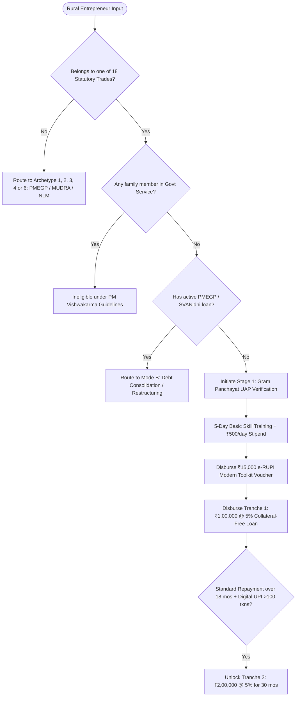

# Archetype 5 Dossier: Traditional Artisans, Crafts & Trades (PM Vishwakarma)
## Statutory Architecture, The 18 Trades, Digital Toolkit Sizing & Dual-Tranche Credit Model

**Project Reference:** SIH-2026-ARCH-05-VISHWAKARMA  
**Category:** Traditional Rural Artisans & Craftsmen (PM Vishwakarma Central Sector Scheme: ₹13,000 Crore Allocation)  
**Target Enterprise Models:**
1. Rural Carpentry & Furniture Fabrication Hub (*Suthar*)
2. Village Apparel, Boutique & Stitching Unit (*Darzi*)
3. Rural Blacksmithing, Iron Implements & Metal Works (*Lohar*)
4. Pottery, Terracotta & Ceramic Craft Unit (*Kumhaar*)  
**Status:** Validated Technical & Financial Standard  

---

## 1. Statutory Architecture: The PM Vishwakarma Revolution

On September 17, 2023, the Government of India launched **PM Vishwakarma**, a transformative Central Sector Scheme (100% funded by GoI) designed to provide end-to-end support to traditional artisans and craftspeople who work with their hands and traditional tools (*Guru-Shishya parampara*).

### 1.1 The 18 Statutory Recognized Family-Based Trades
The scheme strictly recognizes **18 traditional artisan trades** across 4 broad rural occupation clusters:

```
┌────────────────────────────────────────────────────────────────────────────────────────┐
│                        THE 18 STATUTORY PM VISHWAKARMA TRADES                          │
├──────────────────────────────┬─────────────────────────────┬───────────────────────────┤
│ 1. WOOD-BASED TRADES         │ 2. IRON / METAL-BASED TRADES│ 3. STONE & CLAY TRADES    │
├──────────────────────────────┼─────────────────────────────┼───────────────────────────┤
│ • Carpenter (Suthar)         │ • Blacksmith (Lohar)        │ • Potter (Kumhaar)        │
│ • Boat Maker (Nauke Nirmata) │ • Armourer                  │ • Sculptor (Moortikar /   │
│                              │ • Hammer & Tool Kit Maker   │   Stone Carver / Breaker) │
│                              │ • Locksmith                 │ • Mason (Rajmistri)       │
│                              │ • Goldsmith (Sonar)         │                           │
├──────────────────────────────┼─────────────────────────────┼───────────────────────────┤
│ 4. LEATHER-BASED TRADES      │ 5. TEXTILE & WEAVING TRADES │ 6. PERSONAL SERVICE TRADES│
├──────────────────────────────┼─────────────────────────────┼───────────────────────────┤
│ • Cobbler (Charmakar /       │ • Basket/Mat/Broom Maker /  │ • Barber (Naai)           │
│   Shoesmith / Footwear)      │   Coir Weaver               │ • Washerman (Dhobi)       │
│                              │ • Doll & Toy Maker          │ • Tailor (Darzi)          │
│                              │ • Fishing Net Maker         │ • Garland Maker (Malakaar)│
└──────────────────────────────┴─────────────────────────────┴───────────────────────────┘
```

---

## 2. Multi-Tier Support Architecture: Financial, Training & Tools

PM Vishwakarma does not treat the artisan merely as a loan applicant; it constructs a **5-stage holistic elevation pathway**:

```
┌────────────────────────────────────────────────────────────────────────────────────────┐
│                 5-STAGE PM VISHWAKARMA ELEVATION LIFECYCLE                             │
└────────────────────────────────────────────────────────────────────────────────────────┘

 [Stage 1: Verification & Identity]
  • 3-Step Verification: Gram Panchayat / ULB ──> District Committee ──> State Screening
  • Issuance of PM Vishwakarma Certificate & Digital ID Card (QR-verified)
                           │
                           ▼
 [Stage 2: Skill Upgradation & Daily Stipend]
  • Basic Skill Training: 5 to 7 days (40 hours) | Stipend: ₹500 / day
  • Advanced Training: 15 days or more (120 hours) | Stipend: ₹500 / day
                           │
                           ▼
 [Stage 3: Modern Toolkit Incentive (₹15,000 Digital e-Voucher)]
  • e-RUPI Digital Voucher sent directly to artisan's mobile for authorized tool purchase
                           │
                           ▼
 [Stage 4: Collateral-Free Concessional Enterprise Credit]
  • Tranche 1 Loan: Up to ₹1,00,000 (18 months tenure) @ 5% fixed interest
  • Tranche 2 Loan: Up to ₹2,00,000 (30 months tenure) @ 5% fixed interest
    (Eligible after standard repayment of Tranche 1 and adopting digital transactions)
  • Concessional Subvention: MoMSME pays 8% interest subvention directly to banks
  • Guarantee: 100% Credit Guarantee under CGTMSE (Zero collateral, zero processing fee)
                           │
                           ▼
 [Stage 5: Digital Incentives & Market Linkage (GeM / ONDC)]
  • Digital Transaction Cashback: ₹1 per transaction up to 100 transactions/month (₹100/mo)
  • Direct onboarding on Government e-Marketplace (GeM) & Open Network for Digital Commerce
```

---

## 3. Unit Economics & Toolkit Sizing for Key Trades

### 3.1 Model 1: Rural Carpentry & Furniture Fabrication (*Suthar*)
- **Target Products:** Wooden door frames, window shutters, rural cots (*charpai*), school desks, agricultural implement handles.

#### Toolkit & Equipment Decomposition (CapEx)
| Tool / Equipment Item | Technical Grade | Cost (₹) | Financed By |
|---|---|---|---|
| **Circular Saw (7-inch) + Jigsaw** | Industrial 1400W handheld circular saw + variable speed jigsaw | ₹7,500 | PM Vishwakarma e-RUPI |
| **Electric Wood Planer (3-inch)** | 600W portable high-speed planer | ₹3,800 | PM Vishwakarma e-RUPI |
| **Cordless Drill & Impact Driver** | 18V Li-ion cordless drill kit + bit set | ₹3,700 | PM Vishwakarma e-RUPI |
| **Subtotal e-RUPI Toolkit** | | **₹15,000** | **100% Grant** |
| **Heavy-Duty Woodworking Lathe & Chisel Bench** | 4-foot bed wood turning lathe + heavy chuck | ₹28,000 | Tranche 1 Credit |
| **Portable Belt / Disc Sander** | 900W stationary/benchtop sander | ₹12,000 | Tranche 1 Credit |
| **Pneumatic Brad Nailer & Compressor** | 2 HP oil-free compressor + 18G pin gun | ₹18,000 | Tranche 1 Credit |
| **Raw Timber & Plywood Working Stock** | Seasoned teak/eucalyptus planks, commercial ply, adhesives | ₹42,000 | Tranche 1 Credit |
| **Total Enterprise Outlay** | | **₹1,15,000** | **₹15k Grant + ₹1L Loan** |

#### Monthly Cash Flows (Tranche 1 Operation)
- **Monthly Revenue:** 16 furniture/repair jobs @ avg. ₹4,500 = **₹72,000**.
- **Material Costs:** Timber, ply, hinges, polish, screws: ₹34,000.
- **Operating Expenses:** Workshop rent (₹3,000) + Power (₹1,500) + Consumables (₹1,800) = **₹6,300**.
- **Net Operating Income (Pre-EMI):** ₹72,000 - ₹34,000 - ₹6,300 = **₹31,700/month**.
- **Tranche 1 Loan Debt Service:**
  - Loan Amount: ₹1,00,000 @ **5.0% fixed** for 18 months.
  - **Monthly EMI:** **₹5,778**.
  - **Debt Service Coverage Ratio (DSCR):** $\frac{31,700}{5,778} = \mathbf{5.48x}$ (Exceptional credit safety).
  - **Net Take-Home Surplus for Artisan Family:** **₹25,922/month**.

---

### 3.2 Model 2: Village Tailoring & Rural Boutique (*Darzi*)
- **Target Products:** School uniforms, women's salwar suits/blouses, men's shirts, festival clothing.

#### Toolkit & Equipment Decomposition
- **PM Vishwakarma Toolkit (₹15,000 e-RUPI Grant):**
  - Motorized Industrial Direct-Drive Sewing Machine (high-speed lockstitch) with auto-trimmer: **₹15,000**.
- **Tranche 1 Loan Allocation (₹60,000 utilized out of ₹1,00,000 limit):**
  - 4-Thread Overlock / Interlock Machine: ₹16,000
  - Heavy Steam Iron with Vacuum Ironing Table: ₹14,000
  - Working Capital Fabric Inventory (rolls of cotton, linings, threads, buttons, zips): ₹30,000
- **Monthly Cash Flows:**
  - Stitching 120 garments/month @ avg. ₹220 labor = **₹26,400**.
  - Power & thread consumables: ₹2,200.
  - **Net Operating Surplus:** ₹24,200/month.
  - **Tranche 1 EMI (₹60,000 @ 5% for 18 months):** **₹3,467/month**.
  - **Net Monthly Profit:** **₹20,733/month**.

---

## 4. Statutory Guidelines, Exclusions & Digital Verification

### 4.1 Eligibility Criteria & Verification Rules
1. **Age:** Minimum 18 years on the date of registration.
2. **Family Restriction:** Benefits are restricted to **one member per family** ("family" defined as husband, wife, and unmarried children).
3. **Government Employment Bar:** Persons in government service and their family members are ineligible.
4. **Credit Scheme Overlap Restriction:** The beneficiary must not have an outstanding loan under similar credit schemes (PMEGP, PM SVANidhi, MUDRA) within the last 12 months, **except** where those loans have been fully closed or restructured.
5. **3-Tier Verification Hierarchy:**
   - **Tier 1:** Verification by Gram Panchayat Pradhan / Secretary (for rural areas) or Executive Officer (for urban local bodies).
   - **Tier 2:** Screening and recommendation by the District Implementation Committee (chaired by General Manager, District Industries Centre - DIC).
   - **Tier 3:** Approval by the State Level Screening Committee.

---

## 5. Algorithmic Decision Tree for PM Vishwakarma within our Platform



