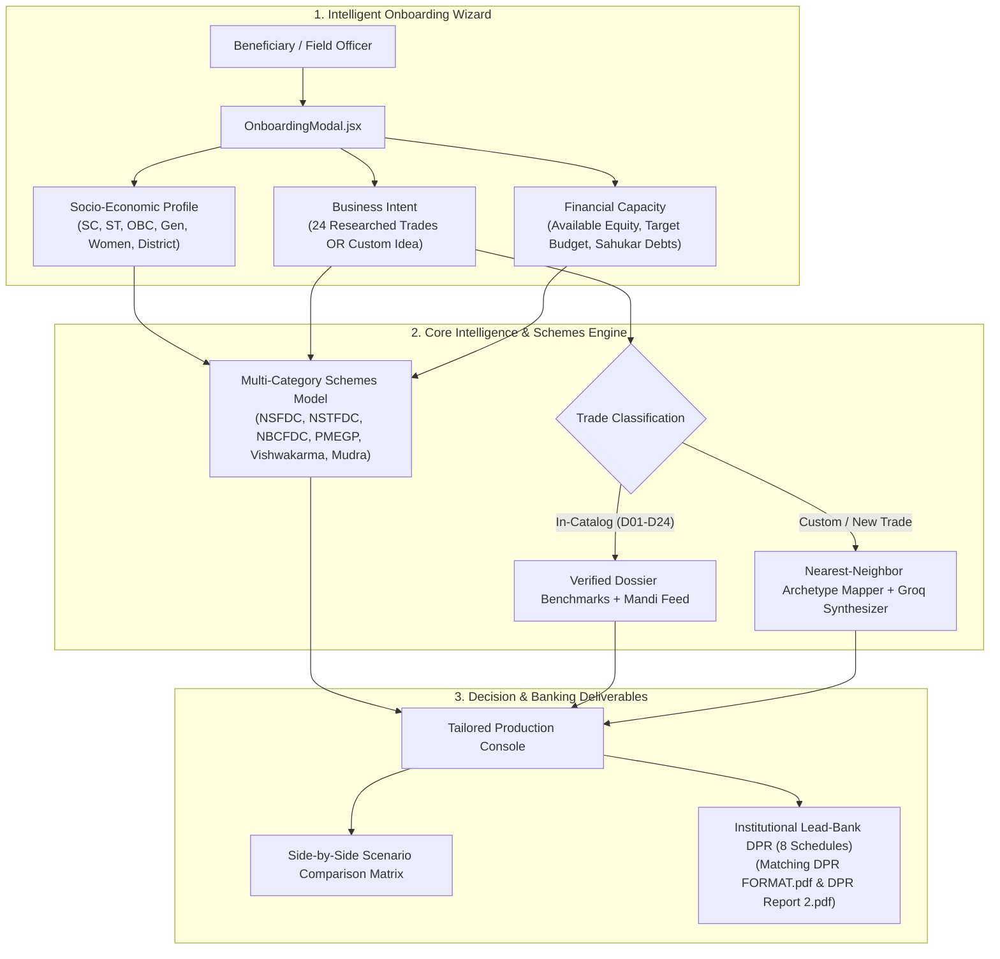

# Comprehensive Platform Audit & Implementation Handover Blueprint
**Project:** UdyamSetuAI (SIH26091 — Concessional Credit & Rural Enterprise Advisory Platform)  
**Author / Auditor:** System Architecture & Advisory Review  
**Date:** November 12, 2026  
**Target Audience:** Project Collaborator & Development Team  
**Core Mandate:** Elevate the platform from an academic static-research viewer into a viable, institutional-grade, personalized rural financial advisory platform without disrupting the core FastAPI + React 19/Vite + Groq architecture.

---

## 1. Executive Summary & Purpose of Handover

Following a rigorous review of user feedback, rural micro-credit realities, and official banking standards (specifically incorporating **`DPR FORMAT.pdf`** and **`DPR Report 2.pdf`**), this audit confirms that **while the mathematical loan calculations and research dossiers are historically rich, the operational flow and user experience are critically disconnected**:

1. **The Onboarding Experience is Broken**: Registration collects basic credentials, but the dashboard immediately drops users into an unguided, hardcoded trade (`D01`) regardless of their selection. There is no intake assessing geographic location, business goals, existing assets, or predatory debt exposure.
2. **The 24-Dossier Wall**: The platform is rigidly restricted to 24 pre-researched codes (`D01`–`D24`). If an entrepreneur wants to start an uncatalogued trade (e.g. *Solar pump repair, EV charging, Bakery, Honey processing*), the platform provides zero guidance.
3. **No Multi-Category Government Schemes Model**: The system is exclusively hardcoded to NSFDC (Scheduled Castes). It cannot evaluate or recommend statutory schemes for **ST, OBC, General/EWS, Women Entrepreneurs, Traditional Artisans (Vishwakarma), or Food Micro-processors (PMFME)**.
4. **The Current DPR is Unusable by Banks**: Generating a DPR currently prints raw code tags (`[S1]`, `[USER INPUT]`), developer notes about dev-server copies, and literally outputs *"6. Gaps: 12 items NOT FOUND in dossier"*. Taking this to an SCA or bank manager guarantees immediate credit rejection.
5. **Scenarios Feature is Incomplete**: Saving a simulation only saves a 4-field card without financial metrics, and there is zero comparative analysis between ventures.
6. **Legal & Security Deficiencies**: Zero Privacy Policy (DPDP Act 2023 non-compliance for sensitive caste/income data) and invalid wildcard CORS configurations in FastAPI.

This document serves as the **official implementation handover** for the collaborator to execute the definitive fixes.

---

## 2. In-Depth Forensic Codebase Audit (With Concrete Code Traces)

### Finding 1: The Onboarding Disconnect & "D01 Cold-Drop"
* **Code Reference**: `frontend/src/App.jsx` (Lines 977–1000) & `frontend/src/components/ProductionDashboard.jsx` (Lines 67–70).
* **The Glitch**:
  1. The registration dropdown in `App.jsx` contains only 6 hardcoded options. The trade labels in the UI conflict with the backend research dossiers (e.g., `D04` is labeled *"Commercial Dairy Unit"* in `App.jsx`, but is *"Seeds Fertiliser"* in `backend/compat.py`; `D08` is labeled *"Mustard Expeller"* in `App.jsx`, but is *"Oil Expellers"* in the backend).
  2. In `ProductionDashboard.jsx`:
     ```javascript
     // Lines 67-70
     const [selectedDomainCode, setSelectedDomainCode] = useState('D01');
     ```
     `ProductionDashboard` **completely ignores `currentUser.trade`** and always resets to `D01` (*Village FMCG Retail*).
  3. The user is presented with no onboarding wizard. There are no questions regarding location (District/State), venture stage (new vs. expansion), available personal savings, or existing informal sahukar debts.

---

### Finding 2: The 24-Dossier Ceiling & Chatbot Handcuffing
* **Code Reference**: `backend/businesses.py` (Line 20) & `backend/chat.py` (Lines 55–64).
* **The Glitch**:
  ```python
  # backend/businesses.py line 20
  ALL_CODES = [f"D{i:02d}" for i in range(1, 25)]
  ```
  Any request for a trade code outside `D01`–`D24` raises an `UnknownCode` 404 error.
  In `backend/chat.py`:
  ```python
  # Lines 58 & 64
  "3. All 24 businesses are listed by list_businesses... If a figure is NOT FOUND, say so."
  "9. Do not list documents, other schemes or steps unless a tool result in this conversation gives them..."
  ```
  The LLM (Groq `gpt-oss-120b`) is prevented from reasoning about any custom trade. If a user asks for guidance on establishing a *mobile repair center* or *mini flour mill*, the chatbot simply states that it has no data.

---

### Finding 3: DPR Output Fails Institutional Banking Standards
* **Code Reference**: `backend/dpr.py` (Lines 227–250).
* **Runtime Output Proof**: Generating a PDF for `D03` prints the following:
  ```text
  Detailed Project Report (1 page) — Rural Electronics Recharge (D03)
  ...
  3. Means of finance and repayment: Project cost: ₹1,40,000 [USER INPUT]...
  ...
  5. Checks for this business: No yes/no questions have been built for this business yet...
  6. Gaps: 12 items NOT FOUND or still open in the dossier
  • [remaining_questions] 1. AI-Assisted Diagnostic Hardware Adoption at Rural Micro-Scale...
  • [remaining_questions] * *Status:* Modern smartphones increasingly deploy complex motherboards...
  • [remaining_questions] 2. Rural Corporate BC Float Credit Lines: Smallholder rural VLEs frequently exhaust...
  ...
  Sources: [S1] NSFDC — Frequently Asked Questions (MoSJE portal) — https://devmosje.negd.in/?p=15629 (Dev-site copy of the MoSJE/NSFDC FAQ page...)
  ```
* **Why This Disqualifies the Borrower**:
  - `DPR FORMAT.pdf` (NABARD standard) and `DPR Report 2.pdf` (Agriculture Infrastructure Fund standard) establish that an official DPR must be a multi-schedule project appraisal containing:
    1. Comprehensive Promoter Profile & Land/Premises Details
    2. Itemized Capital Expenditure & Working Capital Schedules
    3. Means of Finance (Promoter Contribution %, Bank Loan %, Subsidy %)
    4. **5-Year Projected Profitability Table** (Turnover, OpEx, Gross Profit, EBITDA, Net Profit)
    5. Financial Indicators: **Average DSCR, Break-Even Point (BEP %), Payback Period**
    6. Repayment Schedule with Moratorium terms
    7. Statutory Enclosure Checklist & Formal Applicant Declaration
  - Printing internal academic notes stating that 12 required items were *"NOT FOUND"* guarantees immediate bank rejection.

---

### Finding 4: Absence of Multi-Category Schemes Recommendation Model
* **Code Reference**: `backend/loan.py` (Lines 40–80) & `frontend/src/components/ProductionDashboard.jsx`.
* **The Glitch**:
  - The calculation engine is wired strictly to NSFDC Micro Finance (`MCF` $\le$ ₹1.40L @ 6.5%) and Term Loan ($\le$ ₹50L @ 8.0%).
  - If a beneficiary is **ST**, **OBC**, **General / EWS**, a **Woman Entrepreneur**, or a **Traditional Artisan**, the platform fails to recommend the statutory central schemes specifically designed for them:
    - **NSTFDC**: For Scheduled Tribes (Term Loan @ 6%, Adivasi Mahila Sashaktikaran Yojana @ 4%).
    - **NBCFDC**: For Other Backward Classes (New Swarnima @ 5% for women, general term loans).
    - **PMEGP**: Prime Minister's Employment Generation Programme (15%–35% margin money capital subsidy up to ₹50L for manufacturing, ₹20L for services).
    - **PM Vishwakarma**: Collateral-free concessional credit @ 5% + ₹15,000 toolkit incentive for 18 traditional trades (smiths, carpenters, potters, tailors).
    - **Stand-Up India**: Greenfield credit between ₹10L and ₹1Cr for SC, ST, and Women borrowers.
    - **MUDRA (PMMY)**: Shishu ($\le$ ₹50k), Kishore (₹50k–₹5L), and Tarun (₹5L–₹10L) collateral-free working capital.
    - **PMFME**: 35% capital subsidy for micro-food processing units.

---

### Finding 5: Shallow Scenario Engine
* **Code Reference**: `frontend/src/components/ProductionDashboard.jsx` (Lines 378–393).
* **The Glitch**:
  `handleCreateNewSimulation()` stores only:
  ```javascript
  { id, domainCode, tab, name, subtitle, time, type: 'custom' }
  ```
  It does not save financial outcomes (loan amount, equity, monthly surplus, DSCR). Clicking a scenario simply reloads the domain code. There is no side-by-side comparison matrix and no AI guidance helping an entrepreneur choose between different ventures.

---

### Finding 6: Privacy (DPDP Act 2023) & Security Deficiencies
* **Code Reference**: `backend/app.py` (Lines 26–32) & `frontend/src/App.jsx`.
* **The Glitch**:
  1. The platform collects sensitive personal data (Self-declared Caste, Household Income, Mobile/PIN, Moneylender Debt contracts) with **zero Privacy Policy notice** and no explicit statutory consent.
  2. `backend/app.py` configures:
     ```python
     app.add_middleware(
         CORSMiddleware,
         allow_origins=["*"],
         allow_credentials=True,
         allow_methods=["*"],
         allow_headers=["*"],
     )
     ```
     `allow_origins=["*"]` combined with `allow_credentials=True` violates W3C standards and is rejected by modern browsers during authenticated requests.

---

## 3. Handover Architecture & Blueprint

The following 7 blueprints provide the exact implementation specifications for the collaborator.



---

### Blueprint 1: 3-Step Guided Onboarding Modal (`OnboardingModal.jsx`)

Create a responsive, bilingual modal triggered on first registration or via a *"Start New Venture +"* button:
* **Step 1: Beneficiary Profile**:
  - Name, District & State (dropdown with search), Category (**SC / ST / OBC / General / EWS / Minority**), Gender (**Woman Entrepreneur / Male / Transgender**), Annual Family Income.
* **Step 2: Enterprise Goal**:
  - **Option A (Catalog Selection)**: Visual grid of all 24 trades categorized by sector (Agro-Processing, Retail, Livestock, Skilled Trades, Services).
  - **Option B (Custom Venture)**: Freeform input: *"Describe your business idea"* (e.g. "Commercial solar water pump repair", "Organic honey packaging unit").
* **Step 3: Capital Readiness & Moneylender Check**:
  - Estimated capital required (or selector: *Small: <₹1.5L, Medium: ₹1.5L–₹5L, Large: >₹5L*).
  - Moneylender liability check: *"Do you owe money to private sahukars/moneylenders?"* (If yes, pre-populates Mode B Debt Liberation).
* **On Submit**:
  - Persists profile to `userDatabase.js`.
  - Dispatches to `selectedDomainCode` or generates custom trade profile.

---

### Blueprint 2: Universal Schemes Recommendation Model (`backend/schemes.py`)

Implement a rule-grounded scheme matching engine assisted by Groq AI inference:

#### Scheme Eligibility Matrix
1. **Scheduled Caste (SC)**:
   - Project $\le$ ₹1.40L $\rightarrow$ **NSFDC Micro Credit Facility (MCF)** @ 6.5% p.a.
   - Project up to ₹50.00L $\rightarrow$ **NSFDC Term Loan** @ 8.0% p.a.
   - Women $\rightarrow$ **Mahila Samridhi Yojana (MSY)** @ 4.0% p.a.
2. **Scheduled Tribe (ST)**:
   - Routed to **NSTFDC Term Loan** @ 6.0% p.a. or **Adivasi Mahila Sashaktikaran Yojana (AMSY)** @ 4.0% p.a.
3. **Other Backward Classes (OBC)**:
   - Routed to **NBCFDC Swarnima Scheme** @ 5.0% p.a. (Women) or General Loan @ 6.0%–7.0% p.a.
4. **Traditional Artisans & Craftspeople (Any Caste)**:
   - If trade is blacksmith (`D20`), carpenter (`D19`), potter (`D21`), tailor (`D18`):
   - Primary: **PM Vishwakarma Scheme** (₹1.0L Tranche 1 + ₹2.0L Tranche 2 @ 5.0% concessional interest + ₹15,000 digital toolkit incentive).
5. **Manufacturing & Service Micro-Enterprises (All Categories / General / EWS / Women)**:
   - **PMEGP**: 25% subsidy in urban areas, **35% margin money capital subsidy in rural areas** for special categories (SC/ST/OBC/Women/Ex-servicemen); 15%–25% for general category. Maximum project cost ₹50L (Manufacturing), ₹20L (Services).
6. **Agro-Food Processing Micro-Units (`D07`, `D08`, `D09`, `D10`, `D23`)**:
   - **PMFME**: 35% credit-linked capital subsidy up to ₹10.00 Lakhs.
7. **Small Nano-Loans (<₹50,000 to ₹10 Lakhs)**:
   - **MUDRA (PMMY)**: Shishu ($\le$ ₹50,000), Kishore (₹50k–₹5L), Tarun (₹5L–₹10L) collateral-free bank loans.

#### AI Assistance Specification
* The backend constructs the applicant context:
  `{ category, gender, district, state, tradeName, projectCost, annualIncome }`
* Groq LLM evaluates the context against statutory rules and research dossiers, returning the **Top 3 Recommended Schemes** with:
  - Scheme Name & Nodal Agency
  - Exact Concessional Interest Rate & Subsidy %
  - Maximum Loan Ceiling & Margin Money %
  - Strategic Benefit (e.g., *"Under PMEGP, you receive an outright grant of ₹1.75 Lakh (35%), requiring only ₹50,000 own equity"*).

---

### Blueprint 3: Out-of-Catalog Nearest-Neighbor Archetype Adapter

* **API Endpoint**: `POST /api/business/custom`
* **Payload**:
  ```json
  {
    "tradeName": "Solar water pump repair & installation",
    "district": "Sitapur",
    "state": "Uttar Pradesh",
    "projectCost": 250000,
    "applicantCategory": "Scheduled Caste (SC)"
  }
  ```
* **Algorithm**:
  1. **Nearest Archetype Mapping**:
     - Fast keyword/semantic lookup in Python maps the trade to the closest anchor:
       - *Electronics / Solar / Battery / IT* $\rightarrow$ `D03` (*Rural Electronics Recharge*)
       - *Agro / Flour / Oil / Grain* $\rightarrow$ `D08` (*Oil Expellers*) or `D07` (*Dal Milling*)
       - *Machinery / Garage / Two-wheeler* $\rightarrow$ `D15` (*Tractor Garage*) or `D17` (*Auto EV Workshop*)
       - *Craft / Smithy / Fabrication* $\rightarrow$ `D20` (*Metal Smithy*)
  2. **AI Metric Synthesis (Groq `gpt-oss-120b`)**:
     - Groq adapts the anchor archetype's cost breakdown:
       - Fixed Capital vs. Working Capital ratio
       - Operational gross margins and labor costs
       - 12-month seasonal swing multipliers
  3. **Strict Math Invariant**:
     - Statutory loan limits, interest rates, and quarterly EMIs are computed exclusively by Python `loan.py`—the LLM is forbidden from inventing loan formulas.
  4. **Data Tagging**:
     - The custom business object matches the exact schema of `D01`–`D24`, with every synthesized item tagged `[AI-ADAPTED: Anchor D03]`.

---

### Blueprint 4: Institutional Lead-Bank DPR Engine (`backend/dpr.py`)

Refactor `backend/dpr.py` and `LeadBankDprView.jsx` to eliminate raw academic gap lists and implement the 8 official schedules derived from **`DPR FORMAT.pdf`** and **`DPR Report 2.pdf`**:

1. **Header Block**:
   - Government of India / MoSJE / Lead Bank Project Appraisal Format.
   - Scheme Title, Date, Reference Number.
2. **Schedule I: Project Summary & Promoter Profile**:
   - Name of Beneficiary, Address, Village, Mandal, District, State.
   - Mobile Number, Aadhaar / Udyam Registration (Self-declared).
   - Category (SC / ST / OBC / General / Women / Divyangjan).
   - Experience in proposed line of activity.
3. **Schedule II: Technical Details & Activity Profile**:
   - Nature of enterprise, capacity/scale, site suitability, power/water connectivity.
   - Plant & Machinery / Equipment list with costs.
4. **Schedule III: Project Cost Breakdown**:
   - Fixed Capital (Plant, Machinery, Tools, Electrification).
   - Working Capital Requirement (30-day operating expenses).
   - Total Project Outlay.
5. **Schedule IV: Means of Finance & Subsidy Profile**:
   - Promoter Contribution (5%–10% margin money).
   - Concessional Term Loan / Micro Credit (90%–95%).
   - Applicable Government Subsidy / Subvention Details (PMEGP / PMFME / NSFDC).
6. **Schedule V: 5-Year Operating & Cash Flow Projections**:
   - Year 1 through Year 5 tabular schedule:
     - Projected Annual Sales / Turnover
     - Cost of Operations (Raw Materials, Power, Wages, Spares)
     - Gross Profit & EBITDA
     - Annual Debt Service Obligation (Principal + Interest)
     - Net Cash Accruals / Take-Home Surplus to Promoter
7. **Schedule VI: Financial Viability & Repayment Schedule**:
   - Debt Service Coverage Ratio (DSCR) for Years 1, 2, 3.
   - Break-Even Point (BEP %).
   - Repayment Terms: Quarterly instalments with 3-to-6 month moratorium.
8. **Schedule VII: Risk Mitigation & Seasonal Cash Reserve Strategy**:
   - 12-Month seasonal cash flow profile.
   - Working capital contingency reserve for the 3 identified lean months.
9. **Schedule VIII: Statutory Enclosure Checklist & Applicant Declaration**:
   - Checklist: Caste Certificate, Income Certificate, Quotations for Machinery, Bank Passbook, Land/Lease Agreement.
   - Official Certification statement with Signature Block.

---

### Blueprint 5: Side-by-Side Scenario Comparison Matrix

Upgrade `ScenariosSidebar.jsx` and `ProductionDashboard.jsx`:
1. **Full Scenario Persistence**:
   - Update `handleCreateNewSimulation()` to store the complete financial snapshot:
     ```javascript
     {
       id: "SIM-2026-01",
       domainCode: "D03",
       tradeName: "Rural Electronics",
       projectCost: 140000,
       loanAmount: 125000,
       promoterEquity: 15000,
       quarterlyEmi: 12704.49,
       annualSurplus: 344880,
       averageDscr: 3.95,
       leanMonths: ["Jul", "Aug", "Mar"],
       schemeName: "NSFDC Micro Finance",
       timestamp: "12 Nov 2026"
     }
     ```
2. **Comparison Modal**:
   - When 2 or 3 scenarios are saved, display a *"Compare Scenarios"* button.
   - Renders a clean side-by-side comparison matrix.
3. **AI Comparative Verdict**:
   - Calls Groq with the 2–3 scenario JSONs to output a clear, actionable 2-sentence summary:
     > *"Scenario A is superior for low-risk entry, requiring only ₹15,000 personal capital with a high DSCR safety cushion (3.95x). Scenario B generates 1.8x higher annual profit but requires ₹48,000 equity and carries deep monsoon revenue drops."*

---

### Blueprint 6: DPDP Act 2023 Compliance & Privacy Modal

1. **Privacy Policy Component (`PrivacyModal.jsx`)**:
   - Accessible via navigation header and landing footer.
   - Discloses:
     - Purpose limitation: Sensitive data (caste, income, debts) is strictly processed for government concessional credit evaluation.
     - Local-First Architecture: Personal scenarios reside in the user's browser `localStorage`, not persistent external tracking databases.
     - Ephemeral AI Processing: Groq API inference calls are stateless and not used for public model training.
2. **Data Erasure ("Right to be Forgotten")**:
   - In `AccountPanel.jsx`, provide a prominent red button: *"Purge All My Data"*.
   - Wipes `localStorage`, active sessions, and resets application state immediately.

---

### Blueprint 7: Security Hardening

1. **CORS Remediation (`backend/app.py`)**:
   - Replace wildcard `allow_origins=["*"]` with explicit allowed origins:
     ```python
     ALLOWED_ORIGINS = [
         "http://127.0.0.1:8000",
         "http://localhost:8000",
         "http://localhost:5173",
     ]
     ```
2. **Cloud Storage (GCS) Deployment SAIF Policies**:
   - If hosting generated PDFs on Google Cloud Storage:
     - Enable **Uniform Bucket-Level Access (UBLA)**.
     - Strictly prohibit public read access (`allUsers`).
     - Deliver PDFs via **short-lived HMAC signed URLs** (TTL $\le$ 15 minutes) or direct binary streaming through FastAPI.

---

## 4. Implementation Work Plan & File Checklist

| Phase | Tasks & Files to Modify / Create | Verification Command |
| :--- | :--- | :--- |
| **Phase 1: DPR Overhaul** | 1. Refactor `backend/dpr.py` to render the 8-schedule Lead-Bank format.<br>2. Upgrade `frontend/src/components/dashboard/LeadBankDprView.jsx` to render an authentic in-app appraisal sheet.<br>3. Update `backend/tests/test_dpr.py`. | `backend\.venv\Scripts\pytest backend\tests\test_dpr.py` |
| **Phase 2: Schemes Engine** | 1. Create `backend/schemes.py` implementing the multi-category rule matrix (SC, ST, OBC, Gen, Women, Vishwakarma).<br>2. Add endpoint `POST /api/schemes/recommend`.<br>3. Integrate into `backend/app.py`. | `curl -X POST http://127.0.0.1:8000/api/schemes/recommend` |
| **Phase 3: Intake Onboarding** | 1. Create `frontend/src/components/dashboard/OnboardingModal.jsx`.<br>2. Wire into `ProductionDashboard.jsx` and `App.jsx`.<br>3. Fix trade mapping so `currentUser.trade` initializes the dashboard. | `npm run build` & browser test |
| **Phase 4: Custom Trade Adapter** | 1. Create `POST /api/business/custom` in `backend/businesses.py`.<br>2. Wire nearest-neighbor lookup + Groq parameter synthesis.<br>3. Connect to onboarding Option B. | `node --test frontend/test/stageA_*.test.js` |
| **Phase 5: Scenario Comparison** | 1. Update `persistScenarios` in `ProductionDashboard.jsx` to save complete financial states.<br>2. Create `ScenarioComparisonModal.jsx`.<br>3. Add AI comparative verdict. | Browser test scenario matrix |
| **Phase 6: Privacy & Security** | 1. Create `PrivacyModal.jsx` and footer trigger.<br>2. Add "Purge Data" to `AccountPanel.jsx`.<br>3. Fix CORS in `backend/app.py`. | Security check & build |

---

## 5. Verification Protocol for the Collaborator

1. **Automated Unit & Integration Tests**:
   ```powershell
   # 1. Backend test suite
   backend\.venv\Scripts\pytest backend\tests\ -v

   # 2. Frontend test suites
   node --test frontend/test/*.test.js

   # 3. Production build
   cd frontend
   npm run build
   cd ..
   ```
2. **Manual End-to-End Walkthrough**:
   - Register a new user as an **OBC Woman Entrepreneur** in **Sirmaur, HP** wanting to establish an **Organic Spice Grinding Unit**.
   - Verify that the schemes engine recommends **PMEGP (35% rural capital grant)** and **NBCFDC Swarnima Scheme (5% interest)** rather than defaulting to NSFDC.
   - Enter a custom business (e.g. *"Solar water pump service center"*), verify nearest-neighbor binding to `D03`, and verify that the financial numbers are scaled and tagged.
   - Open the **DPR Tab**, verify that the interactive viewer displays the 8 formal banking schedules, and download the PDF to confirm official institutional layout without academic gap dumps.
   - Save 2 scenarios and open the **Scenario Comparison Matrix** to review side-by-side metrics and the AI trade-off verdict.
   - Open the **Privacy Policy**, verify DPDP Act disclosures, and test the *"Purge All My Data"* button.

---
*End of Handover Blueprint. Prepared for immediate collaborator implementation.*

