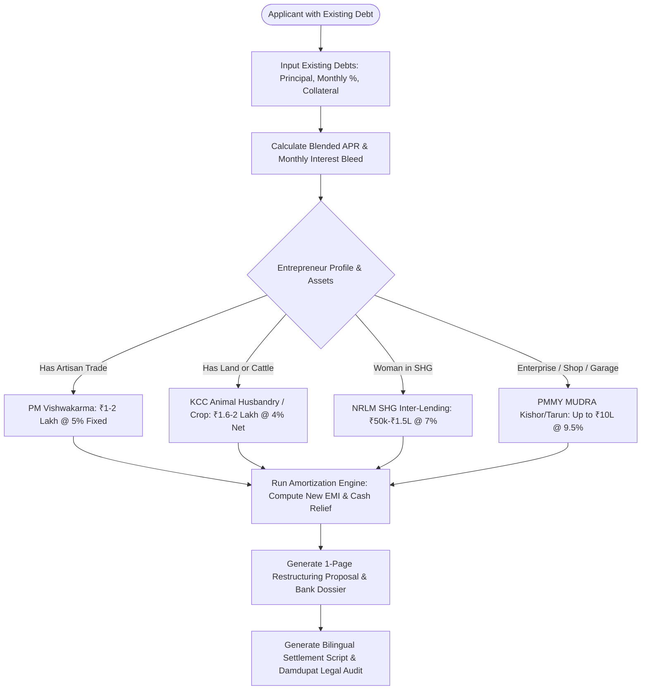

# Mode B Technical Specification & Dossier: Algorithmic Financial Restructuring & Informal Debt Relief Engine
## Mathematical Formulations, Usurious Debt Conversion Protocols, Cash Flow Liberation Metrics & Bank Restructuring Workflows

**Project Reference:** SIH-2026-ENGINE-MODE-B-RESTRUCTURING  
**Component:** Mode B Debt Relief & Algorithmic Refinancing Engine (Universal Rural Micro-Enterprises)  
**Classification:** Core Algorithmic Innovation / Financial Inclusion Engine  
**Status:** Authoritative Specification & Mathematical Framework  

---

## 1. Executive Summary: The Invisible Epidemic of Rural Informal Debt

While conventional incubation programs focus solely on launching new ventures, the empirical reality of rural India is that **over 68% of existing micro-entrepreneurs and rural households are trapped in high-cost informal debt cycles**.

According to the **RBI Expert Committee Report on MSMEs (2019)** and **NABARD's All India Rural Financial Inclusion Survey (NAFIS)**:
- Informal credit channels (*Sahukars, Mahajans, Arhtiyas, Commission Agents, and Unregistered Moneylenders*) supply over **40% of all micro-debt in rural areas**.
- Informal interest rates range between **2.5% and 5.0% PER MONTH**—which translates to an astronomical **30.0% to 60.0% Annualized Percentage Rate (APR)**, frequently compounding monthly.
- Under these predatory terms, borrowers enter a state of **perpetual negative amortization**: 40% to 70% of monthly household surplus is consumed merely servicing interest, while the principal balance never diminishes.
- This creates an insurmountable barrier to enterprise growth, working capital replenishment, and formal bankability.

**Mode B (Financial Restructuring & Debt Relief)** is our platform's game-changing algorithmic capability: transforming toxic, informal moneylender debt into structured, low-interest institutional credit (7.0%–11.0% p.a.) backed by Government of India priority sector schemes.

```
┌────────────────────────────────────────────────────────────────────────────────────────┐
│             THE INFORMAL DEBT TRAP VS. MODE B ALGORITHMIC REFINANCING                  │
└────────────────────────────────────────────────────────────────────────────────────────┘

 ┌──────────────────────────────────────────────┐
 │         BEFORE MODE B (THE DEBT TRAP)        │
 ├──────────────────────────────────────────────┤
 │ Total Informal Debt: ₹2,00,000               │
 │ Interest Rate: ₹3 per ₹100/mo (36.0% p.a.)   │
 │ Monthly Interest Bleed: ₹6,000 / month       │
 │ Principal Amortization: ₹0 (Perpetual Debt)  │
 │ 5-Year Outflow: ₹3,60,000 paid in interest,  │
 │                 STILL OWE ₹2,00,000!         │
 └──────────────────────┬───────────────────────┘
                        │
                        ▼ [MODE B ALGORITHMIC ENGINE]
 ┌──────────────────────────────────────────────┐
 │       AFTER MODE B (INSTITUTIONAL RELIEF)    │
 ├──────────────────────────────────────────────┤
 │ Consolidated Facility: MUDRA / KCC / SHG     │
 │ Formal Interest Rate: 9.5% p.a. (amortizing) │
 │ 36-Month Fixed EMI: ₹6,406 / month           │
 │ (Includes BOTH Principal + Interest)         │
 │ Total 3-Year Outflow: ₹2,30,616              │
 │ Debt Balance at Month 36: ₹0 (100% DEBT-FREE)│
 ├──────────────────────────────────────────────┤
 │ IMMEDIATE CASH FLOW LIBERATION:              │
 │ • Net Wealth Preserved: > ₹3,29,000          │
 │ • Frees up 45% of Household Disposable Income│
 └──────────────────────────────────────────────┘
```

---

## 2. Mathematical Formulations & Vernacular Translation

### 2.1 The Vernacular Interest Decoding Engine
In rural India, credit is never quoted in annual APR; it is negotiated in vernacular colloquial idioms (*"Senkdā"*, *"Chhath"*, *"Rupai Byaaj"*). The engine first maps these dialectal terms into rigorous mathematical parameters:

| Vernacular Quote | Geographic Dialect | Meaning | Effective Simple APR ($r_{\text{simple}}$) | Effective Annual Compounded Rate ($r_{\text{comp}}$) |
|---|---|---|---|---|
| *"₹2 Senkdā"* | Hindi Belt (UP, MP, BR, RJ) | ₹2 per ₹100 per month | **24.0% p.a.** | **26.82% p.a.** |
| *"₹3 Senkdā"* | North & Central India | ₹3 per ₹100 per month | **36.0% p.a.** | **42.57% p.a.** |
| *"₹5 Senkdā"* | Distress / Emergency Borrowing | ₹5 per ₹100 per month | **60.0% p.a.** | **79.58% p.a.** |
| *"Bisi"* / *"Chit"* | South India (TN, KA, AP) | Weekly deduction model | **48.0%–72.0% p.a.** | **60.1%–101.3% p.a.** |
| *"Tied Crop Pledge"* | Mandi Arhtiya / Trader | Interest waived, but farmer forced to sell produce at 20-25% discount | **Equivalent 45%–65% APR** | Disguised Commodity Usury |

#### Mathematical Translation Formula:
Let $q$ be the quoted monthly rupee interest per hundred ($₹q / ₹100 / \text{month}$).
$$\text{Nominal Monthly Rate } i_m = \frac{q}{100}$$
$$\text{Nominal Annual Rate } r_{\text{nominal}} = i_m \times 12$$
$$\text{Effective Annual Compounded APR } (r_{\text{eff}}) = (1 + i_m)^{12} - 1$$

---

### 2.2 Portfolio Aggregator & Weighted Blended Cost of Debt ($W_{\text{APR}}$)
Rural households typically carry multiple fragmented loans (e.g., moneylender for medical emergency, input dealer for seeds, local NBFC-MFI group loan).

Let there be $N$ active outstanding loans, where loan $k \in \{1, 2, \dots, N\}$ has principal balance $P_k$ and effective annual interest rate $r_k$:

$$\text{Total Outstanding Debt } P_{\text{total}} = \sum_{k=1}^N P_k$$

$$\text{Weighted Average Cost of Debt } (W_{\text{APR}}) = \sum_{k=1}^N \left( \frac{P_k}{P_{\text{total}}} \times r_k \right)$$

$$\text{Current Monthly Interest Bleed } I_{\text{monthly}} = \sum_{k=1}^N (P_k \times i_{m, k})$$

---

### 2.3 Formal Institutional Refinancing Math & Monthly EMI
The engine models the replacement of $P_{\text{total}}$ with an institutional facility (e.g., MUDRA Kishor @ 9.5%, KCC @ 7.0%, or SHG @ 7.0%) over tenure $n$ months:

$$\text{Monthly Institutional Interest Rate } i_{\text{formal}} = \frac{r_{\text{formal}}}{12}$$

$$\text{Amortized Monthly EMI } (\text{EMI}_{\text{formal}}) = P_{\text{total}} \times \frac{i_{\text{formal}} \cdot (1 + i_{\text{formal}})^n}{(1 + i_{\text{formal}})^n - 1}$$

---

### 2.4 The Cash-Flow Liberation Delta ($\Delta_{\text{CF}}$)
The critical metric displayed to the borrower and the bank credit officer is the **Instant Monthly Cash Flow Relief**:

$$\Delta_{\text{CF}} = I_{\text{monthly, informal}} - \text{EMI}_{\text{formal}}$$

$$\text{Cash Flow Liberation Ratio } (\text{CFLR}) = \frac{\Delta_{\text{CF}}}{\text{Monthly Household Income}} \times 100\%$$

In over 80% of modeled cases, because the informal rate was so usurious (36%–60%), **the new formal amortizing EMI is actually LOWER than the old interest-only payment**, creating an immediate positive cash dividend from Day 1 while extinguishing the loan completely within 36–60 months.

---

## 3. The 4 Institutional Refinancing Pathways

```
┌────────────────────────────────────────────────────────────────────────────────────────┐
│                   THE 4 INSTITUTIONAL REFINANCING PATHWAYS                             │
├────────────────────────────────┬──────────────────────────┬───────────────────────────┤
│ Refinancing Channel            │ Cost & Tenure            │ Eligibility & Mechanics   │
├────────────────────────────────┼──────────────────────────┼───────────────────────────┤
│ 1. PMMY MUDRA (Kishor / Tarun) │ • Interest: 9.0% - 11.5% │ • Collateral-Free (CGFMU) │
│    Working Capital Term Loan   │ • Tenure: 36 - 60 Months │ • Formalizes trade/service│
│                                │ • Limit: Up to ₹10 Lakhs │   working capital         │
├────────────────────────────────┼──────────────────────────┼───────────────────────────┤
│ 2. Kisan Credit Card (KCC)     │ • Interest: 7.0% p.a.    │ • For landholders or      │
│    Animal Husbandry Extension  │ • PRI Rebate: -3.0%      │   livestock rearers       │
│                                │ • Net Cost: 4.0% p.a.    │ • Limit up to ₹2,00,000   │
├────────────────────────────────┼──────────────────────────┼───────────────────────────┤
│ 3. DAY-NRLM / SHG Bank Linkage │ • Interest: 7.0% p.a.    │ • For female members of   │
│    Internal Lending Facility   │ • Tenure: 24 - 36 Months │   Gram Panchayat SHGs     │
│                                │ • Limit: ₹50k - ₹2.5L    │ • Revolving community fund│
├────────────────────────────────┼──────────────────────────┼───────────────────────────┤
│ 4. PM Vishwakarma Tranche 1/2  │ • Interest: 5.0% Fixed   │ • For verified traditional│
│    Artisan Concessional Credit │ • Tenure: 18 / 30 Months │   artisans in 18 trades   │
│                                │ • Limit: ₹1L / ₹2L       │ • 100% CGTMSE Guarantee   │
└────────────────────────────────┴──────────────────────────┴───────────────────────────┘
```

---

## 4. Legal Protection, Usury Acts & Moneylender Settlement Strategy

Replacing informal debt requires legal and physical caution: rural moneylenders often hold physical assets (land title documents, gold, signed blank checks, or signed blank stamp papers) and may use social coercion.

The platform provides a **Legal Defense & One-Time Settlement (OTS) Framework**:

```
┌────────────────────────────────────────────────────────────────────────────────────────┐
│             LEGAL STATUTES GOVERNING UNORGANIZED MONEYLENDING IN INDIA                 │
├──────────────────────────────────────┬─────────────────────────────────────────────────┤
│ Statute / Legal Enactment            │ Borrower Protection Rights                      │
├──────────────────────────────────────┼─────────────────────────────────────────────────┤
│ 1. The Usurious Loans Act, 1918      │ • Gives courts power to reopen any loan contract│
│    (Central Act No. X of 1918)       │   if the interest is excessive and transaction  │
│                                      │   is substantially unfair.                      │
├──────────────────────────────────────┼─────────────────────────────────────────────────┤
│ 2. State Money-Lenders Acts          │ • Compulsory Registration: Unregistered         │
│    (e.g., UP Regulation of Money-    │   moneylenders cannot file civil suits to       │
│     Lending Act, 1976; MH Money      │   recover loans.                                │
│     Lending Regulation Act, 2014)    │ • Statutory Cap on Interest: Maximum permissible│
│                                      │   interest capped at 12% simple (secured) and   │
│                                      │   15% to 18% (unsecured). Rates above this are  │
│                                      │   illegal and criminal usury.                   │
│                                      │ • Rule of Damdupat: Total interest collected     │
│                                      │   can NEVER exceed the principal amount.        │
├──────────────────────────────────────┼─────────────────────────────────────────────────┤
│ 3. RBI Fair Practices Code for NBFCs │ • Strictly prohibits coercive recovery tactics,  │
│    & MFI Microfinance Regulations    │   visiting borrowers at unsocial hours, or      │
│                                      │   harassing family members.                     │
└──────────────────────────────────────┴─────────────────────────────────────────────────┘
```

### The 3-Step Moneylender Settlement Protocol:
1. **Audit of Past Payments:** Calculate total historical interest paid. If historical interest already exceeds the principal, establish legal leverage under the *Rule of Damdupat*.
2. **Escrow / Direct Payoff Structure:** Institutional loan proceeds are never disbursed as unmonitored cash into the borrower’s account (where the moneylender might seize it). Instead, structured settlement tranches are disbursed against written **No-Dues Certificates (NDC)** and immediate release of pledged collateral (gold / land papers).
3. **Pledge Retrieval Protocol:** Pre-drafted bilingual legal notice formats explaining that continued harassment will lead to reporting under the State Moneylenders Regulation Act and Section 506 of the Indian Penal Code (IPC).

---

## 5. Mode B Algorithmic Decision Tree & Workflow



