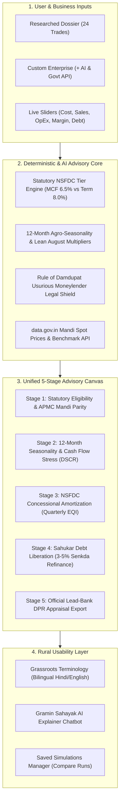

# Comprehensive Advisory Architecture & UX Overhaul Plan (v2.0)
## *GraminAI — Statutory Rural Micro-Enterprise Intelligence Platform (MoSJE / NSFDC SIH26091)*

**Document Name**: `DASHBOARD_ADVISORY_REARCHITECTURE_PLAN.md`  
**Artifact Path**: `C:\Users\LENOVO\.gemini\antigravity\brain\d6f1b76e-bbe9-4f55-bff4-869aa18bdd0f\dashboard_advisory_rearchitecture_plan.md`  
**Repository Path**: `docs/plans/DASHBOARD_ADVISORY_REARCHITECTURE_PLAN.md`

---

## 1. Goal Description & Scope

Transform the GraminAI production dashboard from a rigid, cosmetic UI mockup into an authentic, mathematically verified, input-driven advisory platform tailored for rural Indian micro-entrepreneurs and field officers.

### Core Problems Being Solved:
1. **Broken Dossier Data Binding**: Selecting different dossiers left numbers frozen at ₹1,00,000 due to mismatched JSON keys in `ProductionDashboard.jsx`.
2. **Support for Unlisted / Custom Businesses**: If an applicant wants advice on a business outside the 24 dossiers, the platform must query government open data (`data.gov.in` / Agmarknet / MSME) and apply an AI reasoning model combined with the 6 rural economic archetypes.
3. **Complex Banking Jargon vs. Rural Realities**: Complex terms like *“Amortizer”*, *“CapEx/OpEx”*, *“EQI”*, *“DSCR”*, and *“Moratorium”* confuse rural beneficiaries. The platform will introduce clear, bilingual, everyday Hindi/Hinglish terminology.
4. **Interactive Rural Advisory Chatbot ("Gramin Sahayak")**: A conversational companion integrated into the dashboard to answer questions in plain language (*“What does this instalment mean?”*, *“How does the grace period work in the rainy season?”*).
5. **Purposeless "Recent Scenarios" Sidebar**: The static 3rd column with dummy photos and fake checkboxes will be replaced with a functional **Saved Simulations & Scenario Comparison Manager**.
6. **Unified Reactive State**: Live sliders (Project Cost, Monthly Sales, Monthly Expenses, Promoter Margin, Existing Debt) will reactively update all 5 advisory modules and the final Lead-Bank DPR simultaneously.

---

## 2. Key Solutions & Architecture



---

## 3. Detailed Specifications

### A. Dynamic Dossier Data Binding
Fix the property extraction bug in `ProductionDashboard.jsx` and `api.js`:
* `d.capex_financing.term_loan_tier.project_cost` $\to$ Actual trade CapEx (e.g. ₹6,80,000 for D08 Mustard Mill, ₹1,40,000 for D18 Tailoring, ₹3,50,000 for D12 Goat Farming).
* `d.opex_and_working_capital.monthly_cash_opex` $\to$ Actual monthly operational costs.
* `d.unit_economics.estimated_monthly_turnover` $\to$ Actual monthly gross revenue.
* `d.seasonality.monthly_weights` $\to$ 12-month empirical seasonal weights.
* `d.compliance` & `d.swot` $\to$ Trade regulatory clearances & bank SWOT.

---

### B. Custom Enterprise Advisor (Government API + AI Reasoning)
When a user clicks **`+ Custom Enterprise`**:
1. **User Input**:
   - Enterprise Name / Description (e.g., *"Solar Cold Storage for Vegetables"* or *"Agarbatti & Dhoop Stick Unit"*).
   - District & State (e.g., *Sitapur, Uttar Pradesh*).
2. **Government Platform Intelligence (`data.gov.in`)**:
   - Queries `api.data.gov.in` for matching commodity prices, local APMC mandi arrivals, and district cluster benchmarks.
3. **AI Reasoning Model Integration**:
   - Maps the trade to the most accurate of the **6 Foundational Rural Archetypes**:
     * *Archetype 1*: Value-Addition & Food Processing
     * *Archetype 2*: Rural Retail, Kirana & Agri-Input Supply
     * *Archetype 3*: Rural Technical Services & Machinery Repair
     * *Archetype 4*: Livestock, Dairy & Allied Micro-Farming
     * *Archetype 5*: PM Vishwakarma Artisans & Traditional Trades
     * *Archetype 6*: Circular Bio-Waste & Green Micro-Units
   - Automatically populates suggested CapEx ranges, OpEx margins, and harvest/monsoon seasonality curves.
   - User can accept suggestions or fine-tune sliders.

---

### C. Grassroots Rural Terminology (Bilingual Humanization)
Every technical financial metric is paired with an everyday, accessible Hindi/Hinglish explanation:

| Technical Banking Jargon | Simplified Rural Label (Hindi) | Plain Meaning for Entrepreneur |
| :--- | :--- | :--- |
| **Project Cost / CapEx** | **कुल लागत / शुरू करने का खर्च** | Total money needed to buy machines, tools & setup |
| **Promoter Margin / Equity** | **अपनी जेब से रकम (मार्जिन)** | Money you put from your own pocket (Min 10%) |
| **Sanction Loan Amount** | **सरकारी बैंक से मिलने वाला कर्ज** | Concessional loan sanctioned by NSFDC / Lead Bank |
| **Quarterly Installment (EQI)** | **हर 3 महीने की किश्त** | Repayment made 4 times a year at 6.5% / 8.0% |
| **Moratorium Period** | **किश्त शुरू होने से पहले की छूट** | 3 to 6 months grace period before repayments begin |
| **DSCR / Solvency Rating** | **किश्त चुकाने की ताकत (सुरक्षा रेटिंग)** | Whether your monthly profits easily cover the bank EMI |
| **Net Operating Cash Flow (NOCF)** | **महीने की शुद्ध बचत (मुनाफा)** | Cash left in your hand after paying raw materials & expenses |
| **August Lean Trough** | **अगस्त की मंदी (कम बिक्री का महीना)** | Rainy season dip when rural sales slow down |
| **Debt Refinancing & Damdupat** | **साहूकार के कर्ज से मुक्ति व कानूनी छूट** | Replacing 3% monthly Sahukar debt with 6.5% bank loan |

---

### D. "Gramin Sahayak" (ग्रामीण सहायक) — Integrated AI Explainer Chatbot
* Embedded as a clean slide-out / bottom drawer inside the dashboard.
* **Context-Aware**: Reads the user's active inputs (selected trade, loan amount, monthly EMI, district).
* **Sample Prompts & Answers**:
  * *“What does this 3-month instalment mean for my family?”* $\to$ *“You pay ₹8,420 every 3 months. That is roughly ₹2,800/month from your shop earnings.”*
  * *“Why is August cash flow lower?”* $\to$ *“In August, heavy rains reduce village movement. The platform ensures you keep an extra ₹5,000 buffer so your loan doesn't default.”*
  * *“How does the moneylender relief work?”* $\to$ *“Under the Usurious Loans Act 1918 (Rule of Damdupat), total interest cannot exceed your principal. The platform proves your debt is already repaid.”*

---

### E. Re-Purposing the "Scenarios" Sidebar
* **Remove**: Cosmetic stock photos, disconnected checkboxes, and hardcoded items.
* **Replace With**: **Saved Simulations & Comparison Manager**:
  * Button: `+ Save Active Simulation` (with custom name).
  * Cards showing saved configurations (e.g. *“Mustard Mill - Basic”* vs *“Mustard Mill - With Solar Backup”*).
  * Direct 1-click restoration of any saved simulation into the active workspace.
  * Side-by-side comparison of Quarterly EMI and DSCR.

---

## 4. Proposed Changes by File

### Frontend Core & Viewports
1. `frontend/src/components/ProductionDashboard.jsx`:
   - Correct `dossiers_db.json` field mapping.
   - Centralize live state: `projectCost`, `monthlyTurnover`, `monthlyOpex`, `promoterEquityPct`, `debtPrincipal`, `debtRateSenkda`.
   - Wire dynamic calculations so any input slider update triggers NSFDC Tier calculation, Amortizer, Simulator, and DPR.
2. `frontend/src/components/dashboard/AdvisoryParametersBar.jsx` **[NEW]**:
   - Interactive live sliders and quick-preset buttons (MCF ₹1.40L, Term Loan ₹5L, ₹10L).
3. `frontend/src/components/dashboard/CustomBusinessModal.jsx` **[NEW]**:
   - Custom business dialog invoking government API benchmarks and 6 Archetypes.
4. `frontend/src/components/dashboard/GraminSahayakChat.jsx` **[NEW]**:
   - Conversational AI explainer drawer with pre-built rural queries and live contextual answers.
5. `frontend/src/components/dashboard/NsfdcAmortizerView.jsx`:
   - Bilingual rural terminology (हर 3 महीने की किश्त, छूट का समय).
   - Dynamic EQI and quarterly table bound to live `loanStructure`.
6. `frontend/src/components/dashboard/SeasonalitySimulatorView.jsx`:
   - Live 12-month cash-flow bars recalculated from `monthlyTurnover - monthlyOpex`.
   - Dynamic DSCR calculation and rural solvency explanation.
7. `frontend/src/components/dashboard/ScenariosSidebar.jsx`:
   - Real persistent simulation storage in `localStorage`.
8. `frontend/src/components/dashboard/LeadBankDprView.jsx`:
   - Ensure the generated DPR prints the exact live user-adjusted values.

---

## 5. Verification Plan

### Automated Tests
```powershell
# 1. Build Verification
cd frontend; pnpm run build

# 2. Python Financial Engine Tests
.\.venv\Scripts\python.exe scripts/test_m1_empirics.py
```

### Manual Verification Matrix
1. **Dossier Switching**: Switch between D08 (Mustard), D18 (Tailoring), and D12 (Goat Farming). Verify all numbers, costs, and cash flows update immediately.
2. **Custom Enterprise Flow**: Create "Mini Solar Cold Storage" under Archetype 1. Verify government API data populates and full appraisal is produced.
3. **Parameter Sliders**: Drag Project Cost from ₹1,00,000 to ₹8,00,000. Verify automatic shift from MCF (6.5%, 11 qtrs) to Term Loan (8.0%, 26 qtrs).
4. **Rural Terminology**: Verify every card displays simple Hindi/Hinglish explanations alongside bank metrics.
5. **Gramin Sahayak Chatbot**: Ask questions about quarterly EMI and August lean season; verify contextually accurate responses.
